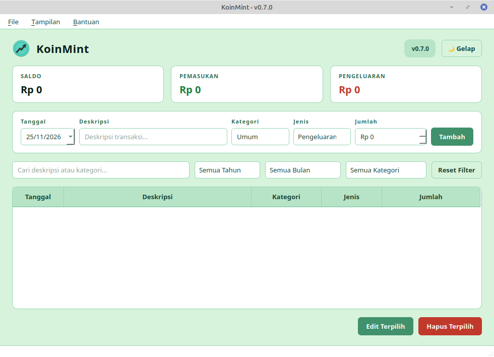
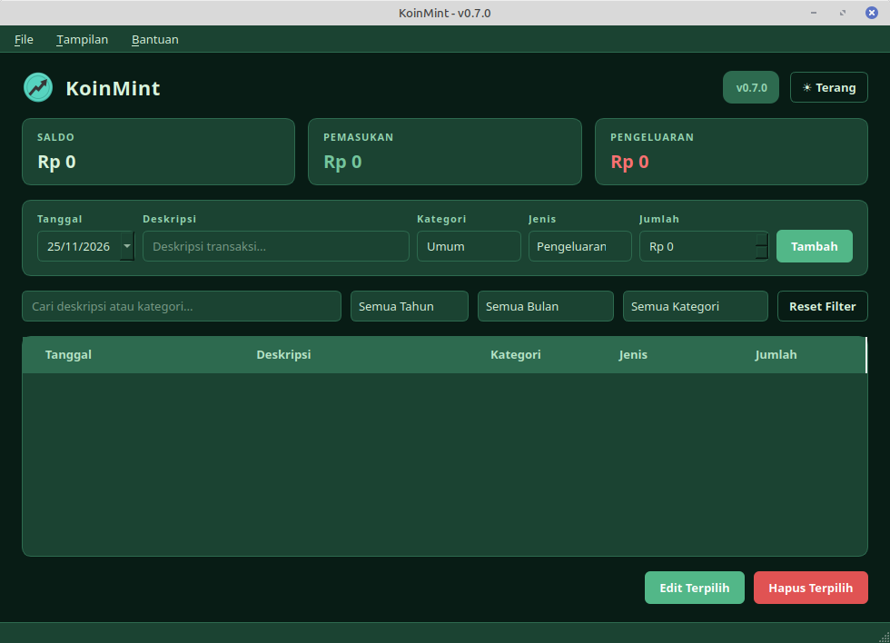

<center></center>

<center><h1>KoinMint</h1></center>

## 📖 Tentang KoinMint

**KoinMint** adalah aplikasi desktop pencatatan pemasukan dan pengeluaran harian berbasis **Python** dan **PyQt5** yang dirancang khusus untuk kenyamanan pengguna desktop Linux.

Aplikasi ini berjalan **100% offline** tanpa memerlukan koneksi internet maupun akun cloud. Seluruh catatan keuanganmu disimpan secara lokal dan aman di direktori pengguna (`~/.local/share/koinmint/transactions.json`) dengan antarmuka bertema *Fresh Greens* yang mendukung **Mode Terang (Light Mode)** dan **Mode Gelap (Dark Mode)**.

> **ℹ️ Catatan Dukungan Sistem Operasi:**
> Saat ini **KoinMint** baru tersedia dan diuji untuk sistem operasi **Linux berbasis Debian** (seperti **Linux Mint**, **Ubuntu**, dan **Debian**) melalui paket instalasi `.deb`. Dukungan dan paket installer untuk **Windows** sedang dalam tahap pengembangan (*Coming Soon*).

## ✨ Fitur Utama

* **📊 Ringkasan Keuangan Real-Time:** Kartu informasi untuk **Saldo**, **Pemasukan**, dan **Pengeluaran** yang otomatis menghitung ulang sesuai filter periode atau kategori yang sedang aktif.

* **🔍 Pencarian & Filter Multi-Kriteria:** Saring data transaksi secara instan berdasarkan kata kunci deskripsi, **Tahun**, **Bulan**, dan **Kategori**, dilengkapi tombol *Reset Filter* satu klik.

* **🌗 Tema Terang & Gelap (*Fresh Greens*):** Beralih antara mode terang yang segar dan mode gelap yang pekat (`Ctrl+T`), dengan preferensi tema yang tersimpan otomatis.

* **📥 Impor & 📤 Ekspor CSV:**

  * Ekspor hasil filter ke berkas `.csv` (`Ctrl+E`) dengan encoding `UTF-8-SIG` (siap dibuka di LibreOffice Calc maupun Microsoft Excel).

  * Impor data dari berkas `.csv` (`Ctrl+O`) dengan deteksi kolom dan format tanggal/angka yang fleksibel.

* **✏️ Manajemen Transaksi Lengkap (CRUD):** Tambah, edit (klik ganda pada baris atau klik *Edit Terpilih*), dan hapus transaksi dengan validasi input yang aman.

* **💾 Penyimpanan Lokal & Atomik:** Penulisan berkas JSON dilakukan secara atomik (`.tmp` lalu *replace*) untuk mencegah kerusakan data apabila aplikasi tertutup mendadak.

## 📸 Tangkapan Layar


 <center> </center>

## 🚀 Instalasi

### Opsi 1: Menggunakan Paket `.deb` (Direkomendasikan untuk Linux Mint / Ubuntu / Debian)

1. Unduh berkas `koinmint_0.7.0_amd64.deb` terbaru dari halaman [**Releases**](../../releases).

2. Buka terminal di folder tempat berkas diunduh, lalu jalankan:

   ```
   sudo apt install ./koinmint_0.7.0_amd64.deb
   
   ```

3. Setelah terpasang, buka **KoinMint** langsung melalui menu aplikasi desktop (*Office / Finance*) atau jalankan perintah `koinmint` di terminal.

### Opsi 2: Menjalankan dari Source Code (Linux Berbasis Debian)

Pastikan **Python 3** sudah terpasang di sistemmu:

```
# 1. Clone repositori ini
git clone https://github.com/USERNAME_KAMU/koinmint.git
cd koinmint/src

# 2. Buat dan aktifkan virtual environment
python3 -m venv venv
source venv/bin/activate

# 3. Instal dependensi
pip install PyQt5

# 4. Jalankan aplikasi
python3 main.py

```

## ⌨️ Pintasan Keyboard (*Shortcuts*)

| Pintasan | Fungsi | 
| ----- | ----- | 
| `Ctrl + O` | Impor transaksi dari berkas CSV | 
| `Ctrl + E` | Ekspor transaksi aktif ke berkas CSV | 
| `Ctrl + T` | Ganti tema Terang / Gelap | 
| `Ctrl + Q` | Keluar dari aplikasi | 
| `Double Click` pada baris | Membuka dialog Edit Transaksi | 

## 📄 Format Impor & Ekspor CSV

Berkas CSV yang diekspor maupun diimpor menggunakan struktur kolom standar sebagai berikut:

```
Tanggal,Deskripsi,Kategori,Jenis,Jumlah (Rp)
2026-11-25,Gaji Bulanan,Gaji,Pemasukan,5000000
2026-11-25,Makan Siang,Makan,Pengeluaran,-35000

```

* **Tanggal:** Mendukung format `YYYY-MM-DD` maupun `DD/MM/YYYY`.

* **Jenis:** Mendukung `Pemasukan` / `Income` dan `Pengeluaran` / `Expense`.

* **Jumlah:** Mendukung angka polos maupun format pemisah ribuan.

## 🗂️ Struktur Proyek

```
koinmint/
├── docs/
│   └── screenshots/          # Gambar tangkapan layar untuk dokumentasi
│       ├── preview-light.png
│       └── preview-dark.png
├── src/
│   ├── assets/
│   │   └── koinmint.png      # Ikon utama aplikasi
│   ├── main.py               # Entry point aplikasi
│   ├── models.py             # Metadata aplikasi & dataclass Transaction
│   ├── store.py              # Manajemen penyimpanan JSON lokal & atomik
│   └── ui.py                 # Antarmuka PyQt5, tema Fresh Greens, & CSV handler
├── .gitignore
├── LICENSE
└── README.md

```

## 📍 Lokasi Penyimpanan Data

* **Berkas Transaksi:** `~/.local/share/koinmint/transactions.json`

* **Preferensi Tema:** Tersimpan otomatis melalui `QSettings` pada sistem pengguna.

## 📝 Lisensi

Proyek ini didistribusikan di bawah lisensi **MIT License**. Silakan lihat berkas [LICENSE](LICENSE) untuk informasi selengkapnya.